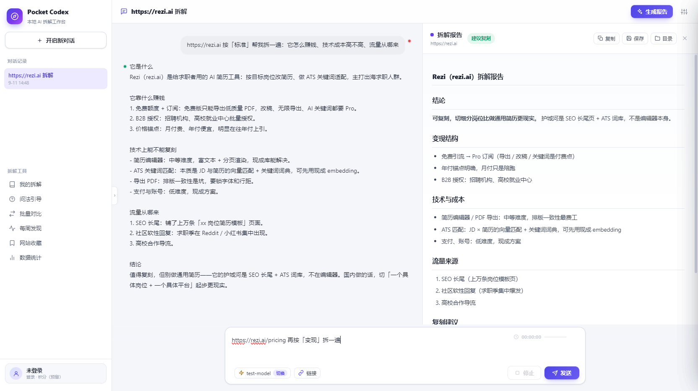
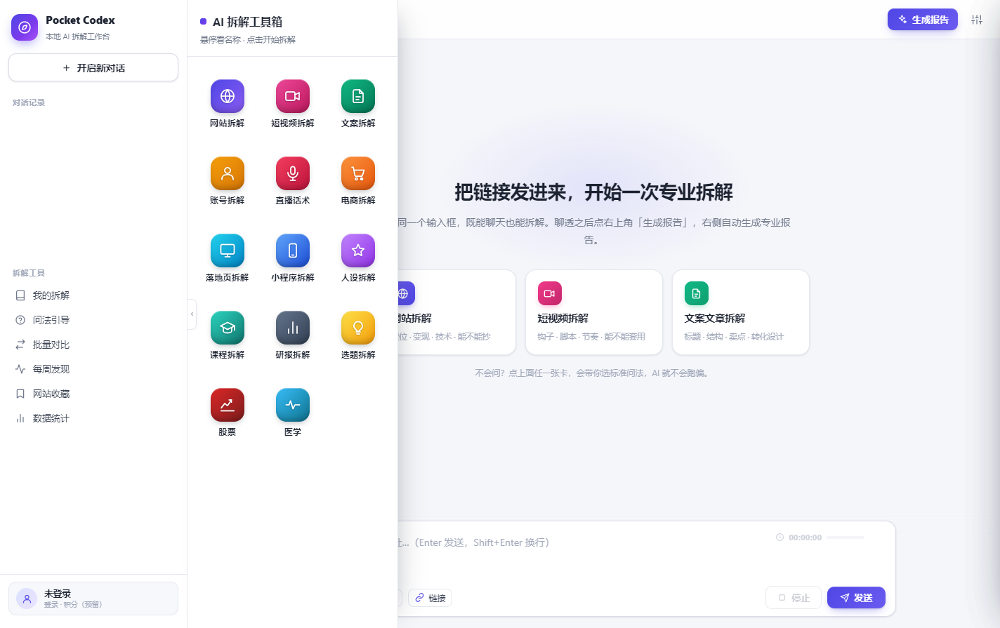
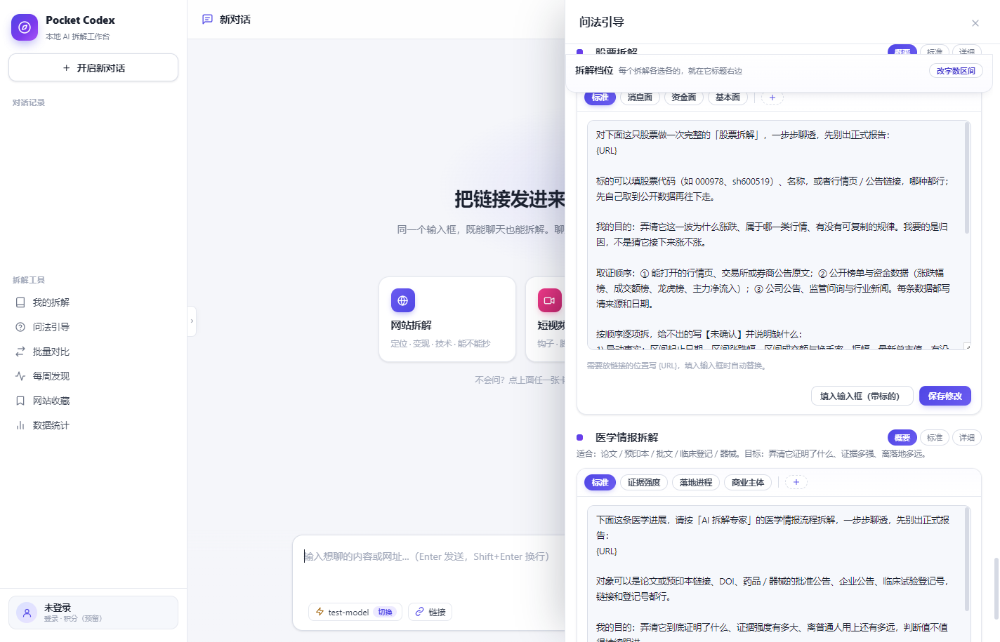
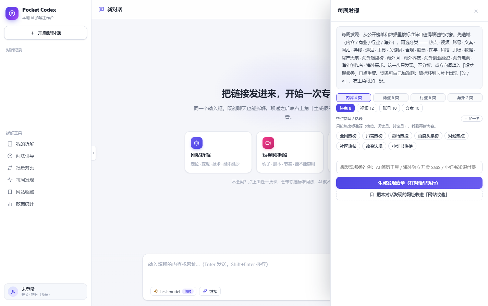
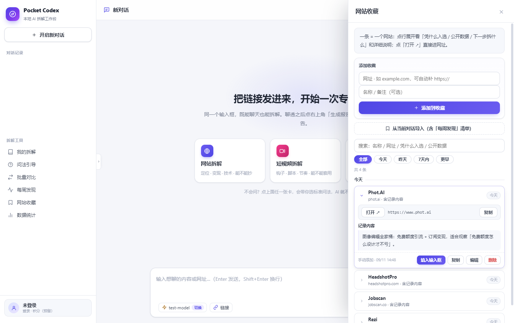
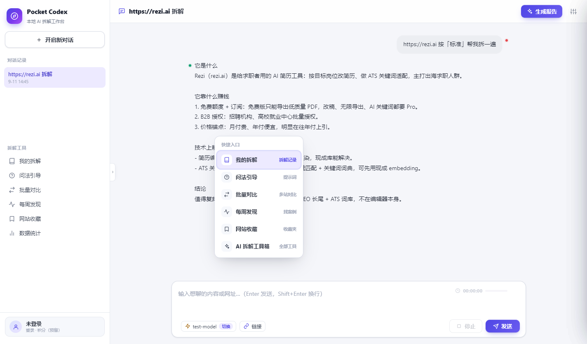
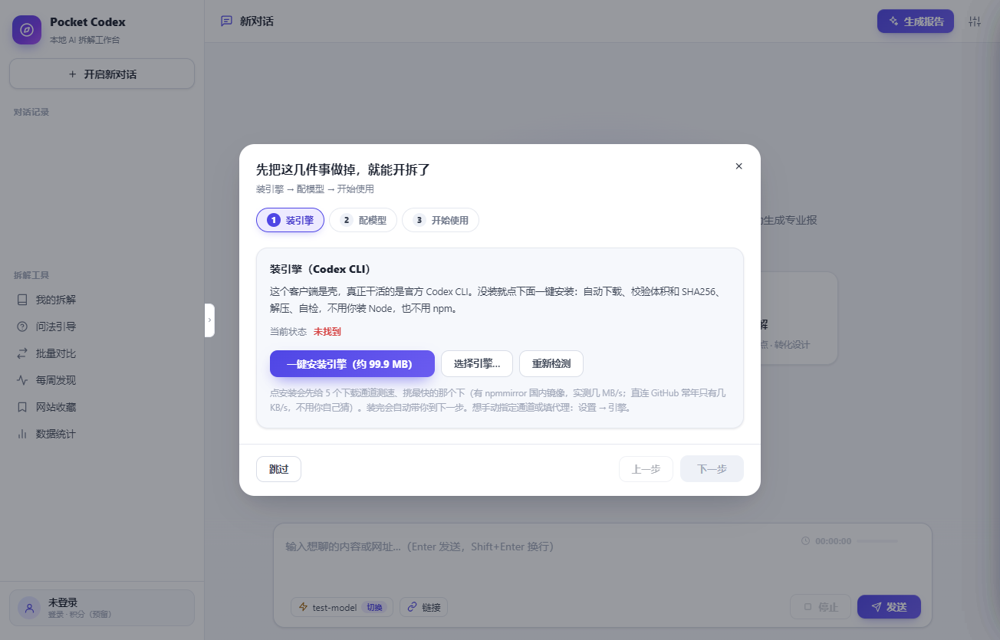
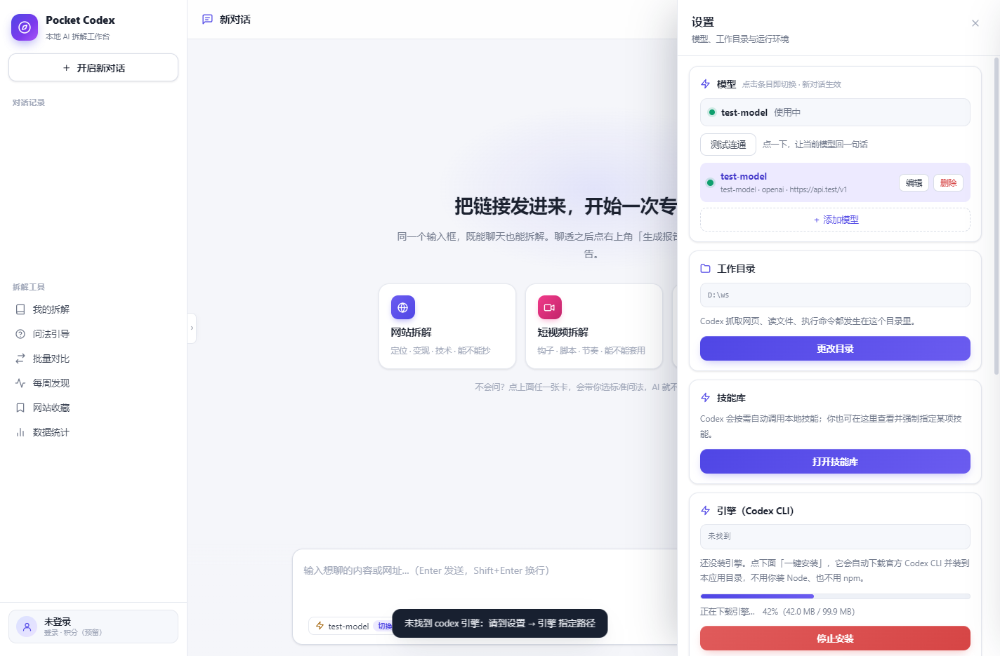
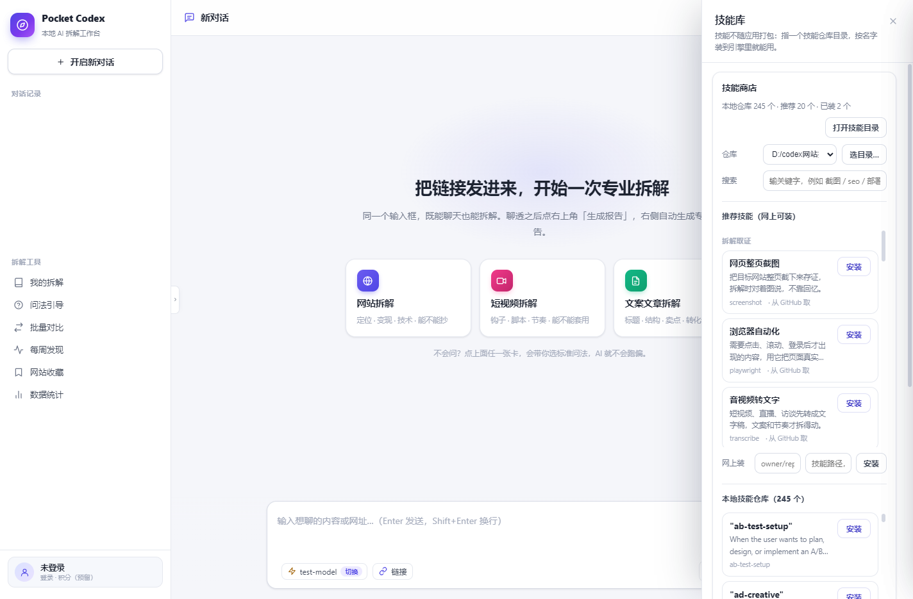

# Pocket Codex · AI 拆解专家

> 把链接丢进去，AI 按专业问法一层层拆开：**它是什么、靠什么赚钱、技术能不能复刻、流量从哪来、值不值得抄**。
> 网站、短视频、文案、账号、直播、商品、课程、股票、论文…… 14 类都能拆，聊明白了一键出报告。

**下载：[最新版 Windows 安装包](https://github.com/wangjianlin2026/pocket-codex/releases/latest)** —— 当前版本 **v0.1.69**，Windows x64，双击安装，装完自动送 **7 天试用**，第一次打开有向导带你走完。



对话、报告、收藏都在你自己的电脑上：**没有账号、没有云端、不上传任何内容**。
底层调用本机的 [codex](https://github.com/openai/codex) CLI，模型用你自己的 key（应用不提供、也不碰你的 key）。

---

## 它能帮你解决什么问题

| 你的处境 | 它怎么帮你 | 用哪个 |
| --- | --- | --- |
| 看到一个网站或 App 挺挣钱，想搞清它怎么赚钱、自己能不能做 | 按 变现 / 技术 / 流量 / 复刻 四个角度拆一遍：成本、护城河、流量来源一次说清 | 网站拆解、App 拆解 |
| 一条短视频火了，想知道它凭什么火、文案怎么写的 | 拆前 3 秒钩子、节奏结构、情绪曲线，给出能直接套的标题模板和脚本骨架 | 短视频拆解 |
| 一堆同行链接要横向比，人眼看不过来 | 多个链接一起丢进去，按同一套维度并排出结论 | 批量对比 |
| 想做点事，但不知道从哪下手 | 按标准从公开榜单里筛：热点、爆款视频、有价值网站、赚钱方向、涨幅榜…… | 每周发现 |
| 筛出来的对象看一眼就忘了 | 勾一下进收藏，把"为什么值得拆、靠什么赚钱、从哪发现的"一起存下来 | 网站收藏 |
| 得给别人交付一份分析，不想自己排版 | 聊到能出结论，一键生成结构化报告，可复制、可存盘 | 生成报告 |
| 一只股票突然异动，想知道为什么 | 填代码或名称，按行情 / 资金面 / 基本面 / 消息面逐条归因 | 股票拆解 |
| 一篇论文或新药获批，想知道到底证明了什么 | 拆证据强度、落地进程、商业主体，判断离普通人还有多远 | 医学情报 |
| 一篇文章太长，只想看中心思想 | 按段落抽要点，压到你一眼能扫完的篇幅 | 文案 / 文章拆解 |
| 看到一个账号做起来了，想搞懂它的路子 | 拆人设、选题、更新节奏、变现路径 | 账号拆解、个人 IP 拆解 |

**一句话：只要是"想弄明白别人怎么做的、能不能为我所用"，它都能拆。**

## 它能做什么

- **对话式拆解**：一个输入框，既能闲聊也能拆解。链接丢进去就开拆，拆得不满意接着追问，不用换工具。
- **拆解工具箱（14 类）**：网站 / 短视频 / 文案文章 / 账号 / 直播话术 / 电商 / 落地页 / App / 个人IP / 课程 / 行业报告 / 选题，加上行业类的**股票拆解**和**医学情报**。每类内置标准问法 + 若干专项角度（网站就有：标准 / 变现 / 技术 / 流量 / 复刻 / 安全）。界面是**大图标**，点开先选角度，确认后**自动新开一个对话**，把提示词和链接一起带进去。
- **问法引导**：把"该怎么问 AI"做成可编辑的提示词卡片，避免问偏、问浅；不会问就点「填入输入框」，它把标准问法写进去，你再改两个字就能发。
- **拆解档位**：每个拆解类型能单独选 **概要 / 标准 / 详细**（默认概要，字数区间自己填）——想一眼看懂就概要，想逐条抠就详细。
- **生成报告**：聊到能出结论，点右上角「生成报告」，右侧并排出一份结构化报告，可复制、可存盘。
- **对话里直接出图 / 出视频**：说一句「生成一张赛博朋克城市夜景」或「生成一段 5 秒视频：一只猫在草地上跑」，它就调你登记好的图片 / 视频模型把图、视频做出来，文件存到桌面（或当前工作目录），对话里直接看。想指定模型就点名，例如「用 agnes-video-2.5 生成…」——点名优先于登记台里那条「使用中」。
- **批量对比**：多个链接按同一套维度横向比，谁强谁弱一眼看出来。
- **报告里能装图**：表格、折线图 / 柱状图 / 饼图（AI 直接画出来）、封面图、原片视频（mp4）都能摆在报告里，点链接自动用系统浏览器打开——结论不用再挤成一大段文字。
- **每周发现**：四个域（内容 / 商业 / 行业 / 海外）、二十三个分类、**222 条方向词**。选完域和分类点一下就生成发现清单；清单里搜出来的对象可以勾选，一键收进网站收藏。
- **网站收藏**：存的不只是链接——为什么值得拆、靠什么赚钱、从哪发现的都记着；可搜索、可按时间筛、可增删改，输入框里还能一键填回链接，反复拆同一个不用翻收藏夹。
- **提示词不写死**：问法引导、工具箱每个角度、每周发现的方向词，都能自己加、改、删。哪条问得不对，当场改。
- **右键就是快捷键**：界面里点右键，直接叫出 我的拆解 / 问法引导 / 批量对比 / 每周发现 / 网站收藏 / 工具箱。
- **我的拆解 / 数据统计**：历史报告回看、用了多少一眼可见。
- **技能商店**：内置 20 个推荐技能（拆解取证 / 安全合规 / 变现落地 / 效率辅助），点「安装」按来源从网上取；也可以把「仓库」指到自己的技能目录按名字装 / 卸。出图 / 出视频要用的 Agnes 技能随应用自带，装完就有，不用手动装。
- **多类型模型登记**：文本模型只管聊天；图片 / 视频 / 音频模型单独登记（内置 Agnes 图片 / Agnes 视频预设，视频带一个 **$0/秒的免费档**），每种类型各有自己的「使用中」，想换点一下就换。密钥、接口地址、模型 ID 都从登记台带进技能的环境变量，技能里不写死 —— 换模型不用改技能文件。
- **语音对话**：不想打字就按住说话，转成文字直接发；音色能点「试听」，挑一个顺耳的再换。
- **知识库**：录音、视频、图片丢进去自动转写 / 识字，都在本机跑；攒下来的问法越用越顺手。
- **外观**：内置一批壁纸，也能把自己喜欢的图加进「我的图」，随时换。

## 三步用起来

> 不用装 Node、不用 npm、不用自己下 codex —— 装引擎就是应用里的一个按钮。

1. **下载安装**：到 [Releases](https://github.com/wangjianlin2026/pocket-codex/releases/latest) 下载 `PocketCodex-Setup-x.y.z.exe`，双击，一路下一步（可以改安装目录）。
2. **打开应用，跟着向导走**：第一次启动会自动弹**引导向导**——装引擎 → 配模型 → 开始使用。做到哪一步、还差什么，向导自己判断；不想看就点「跳过」，以后从「设置 → 初次使用」还能叫出来。
   - **装引擎**：点「一键安装引擎」，它先给几条下载通道**测速挑最快的**，再自动下载 → 校验体积和 SHA256 → 解压 → 跑一次 `codex --version` 自检。断了支持断点续传。
   - **配模型**：跳去「设置 → 模型 → 添加模型」，填 `base_url` + `api key`（用你自己的额度）。关掉设置，向导自动接着走。
   - **试连通**：点一下，让模型真回一句话，通了才算配好。
3. **开始拆解**：把链接发进输入框就能开拆；聊到能出结论，点右上角「生成报告」。

```
下载安装包 → 双击安装 → 打开应用 → 自动弹出「首次启动向导」
  ├─ 第 1 步 装引擎：本机已有→跳过；没有→「一键安装引擎」
  │            下载 → 校验体积 + SHA256 → 解压 → 自检
  │            失败就换通道 / 填代理，再点一次（会断点续传）
  ├─ 第 2 步 配模型：base_url + api key（跳去设置，回来接着走）
  └─ 第 3 步 开始使用
发链接开始拆解
```

### 装完东西都在哪

| 东西 | 位置 |
| --- | --- |
| 引擎本体（`codex.exe`） | 跟应用装在一起：`<安装目录>\engine\cli\`（应用目录写不了时退到 `%APPDATA%\pocket-codex\engine\`） |
| 引擎的数据目录（`config.toml` 等） | `<安装目录>\data\engine\home\` |
| 你的对话、网站收藏、发现清单 | `<安装目录>\data\pocket-store.json` |
| 生成的报告 | `<安装目录>\data\reports\` |
| 装好的技能 | `<安装目录>\data\engine\home\skills\` |
| 运行日志 | `<安装目录>\data\logs\` |

引擎是**应用自己装、版本锁死**的：界面和引擎是一套，不看你机器上碰巧装了什么 codex，所以不会出现"版本对不上"的怪问题。

整个软件就是一个文件夹（便携版）：数据、引擎都在它自己目录下，**不往系统盘（`C:`）写东西**，拷到别的电脑或插 U 盘照样能用。**要备份，把整个安装目录拷走就行。**

## 界面截图

### AI 拆解工具箱：14 类，一行 3 个



图标下面就是名字，鼠标移上去出全名；点开先选拆解角度，确认后自动新开一个对话把提示词和链接带进去。

### 问法引导 + 拆解档位



每个拆解类型能单独选 概要 / 标准 / 详细，也能加自己的问法。

### 每周发现：按标准先把对象筛出来



四个域、二十三个分类、222 条方向词；搜出来的对象可以勾选，一键收进网站收藏。

### 网站收藏：一条一条，展开就是详情



为什么值得拆、靠什么赚钱、从哪发现的，都记着。

### 右键就是快捷键



### 首次启动向导



装引擎 → 配模型 → 开始使用，缺哪一步就卡在哪一步。

### 一键安装引擎



自动挑最快通道，下载、校验、解压、自检全在应用里完成。

### 技能商店



内置 20 个推荐技能，点「安装」按来源从网上取；也能指到自己的技能目录按名字装。

## 常见问题

- **下载到一半失败**：换通道或填代理，再点一次，会接着下（支持断点续传）。
- **通道挑哪个**：默认「自动」——安装前先给每条通道测速，挑最快的下。国内通常 **npmmirror 镜像**最快（同一份官方引擎，实测几 MB/s）。
- **杀软报毒**：个别杀软会把这类命令行工具误判。引擎来自官方 Release，应用会校验体积和 SHA256；请加白名单，或临时关掉实时防护再装。
- **磁盘占用**：下载包 100 MB（官方）或 136 MB（镜像），解压后约 285 MB，安装峰值约需 600 MB 空余；装完会清掉临时文件。
- **提示"额度不足"**：这是你自己 key 的额度问题，与本应用无关。想提前知道通不通，到「设置 → 模型 → 测试连通」点一下，它会真发一句话给模型。
- **出图 / 出视频没出来**：上游偶尔抽风（报 500、超时之类），应用会自动重试；连续失败就是上游或额度问题，换个图片 / 视频模型再试。
- **它只给我一段提示词、不动手**：这是模型「发不出工具调用」（参数是空的）的毛病，出在模型网关侧。应用会认出来并自动重试；重试还不行会明确告诉你「新开一个对话」或「换个文本模型」——不是你的提示词写错了。
- **装了不生效**：完全退出应用再重开（托盘图标也要退），设置才会全部重新加载。
- **7 天试用到期了**：应用会弹出激活页（关不掉），照着页面做三步：复制机器码 → 加作者微信发过来 → 把收到的授权码粘回去点「激活授权码」，激活后接着用。

## 反馈

用着不顺手、发现毛病、或者想要某个拆解类型，点仓库上面的 **Issues** 标签留一句就行。

## 免责声明

本工具用于对**公开可见信息**的学习、研究与分析。使用者应自行遵守目标网站的服务条款与所在地区法律法规；
不得用于未授权访问、抓取他人非公开数据或其他违法用途。项目不提供任何模型 API key。

---

## English (brief)

**Pocket Codex** is a local desktop teardown/analysis workbench. Drop in a link — a website, a short video, an
article, an account, a product page — and it runs a structured teardown with you: what it is, how it makes money,
how hard it would be to rebuild, where its traffic comes from, and whether it is worth copying. Chat about it,
then generate a structured report with one click. 14 teardown types, plus a discovery desk that screens public
rankings and leaderboards for things worth looking at.

You bring your own model credentials (base_url + API key); the app ships no keys and no model, and it runs
entirely on your machine — no account, no cloud.

It also generates images and short videos on request: ask for a picture or a 5-second clip and it calls the image /
video model you registered (an Agnes preset ships with the app), saving the file to your desktop.

A first-run wizard walks you through: install the codex engine (one click; it speed-tests every download channel
and picks the fastest) → configure a model → test the connection. Windows x64, packaged with electron-builder.
